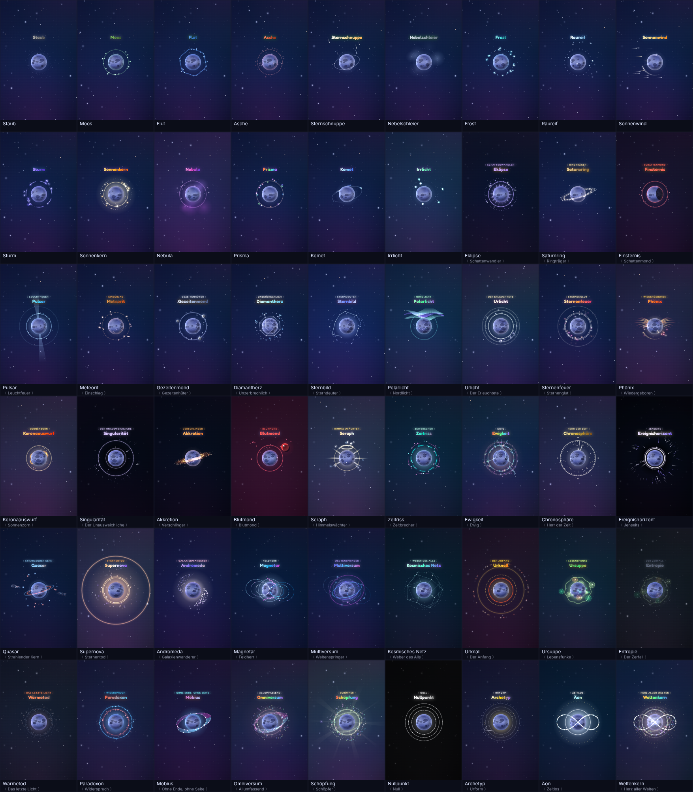
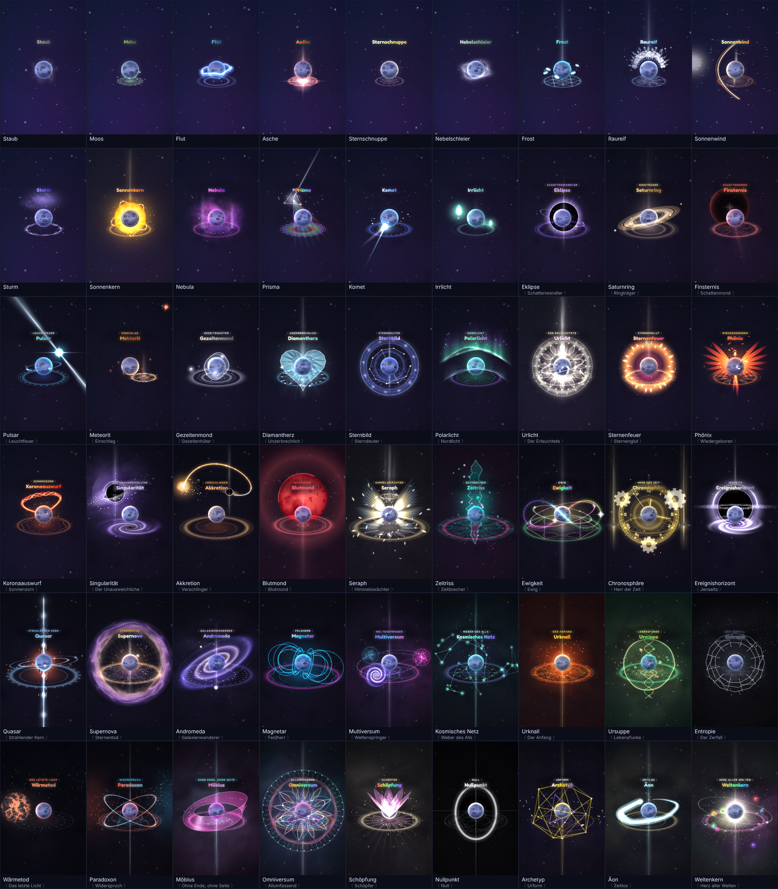
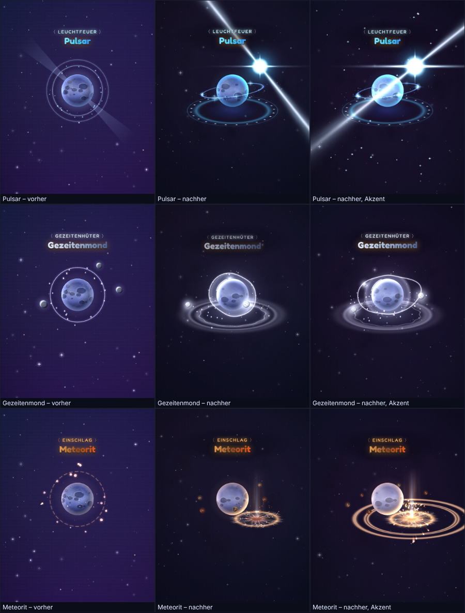
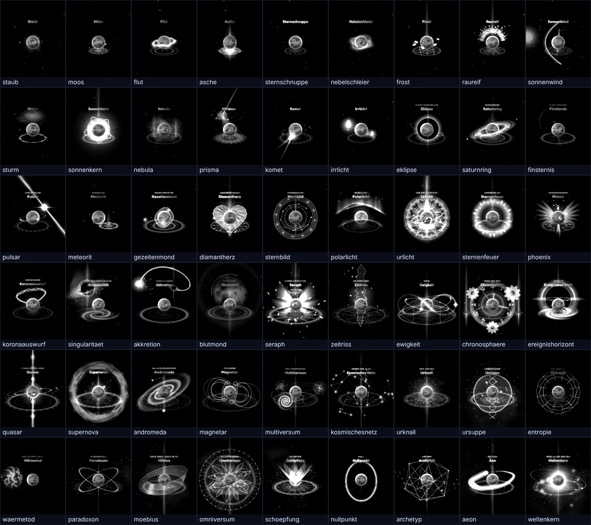
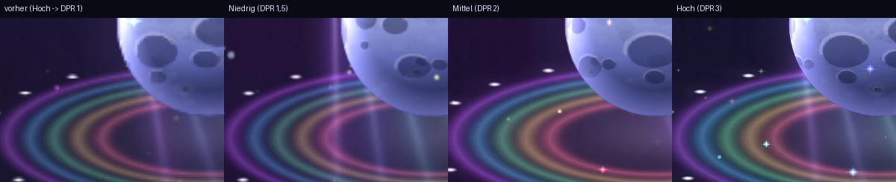

# Abschlussbericht – Planet RNG (Neuaufbau)

Das Spiel ist komplett neu gebaut. Ergebnis ist eine einzige Datei, `planet-rng.html`
(ca. 890 KB, davon ca. 270 KB Deep Boom und ca. 65 KB Schrift), die per Doppelklick offline läuft.

## Was gebaut ist

**Kern und Glück**
- 54 Auren in 16 Stufen: die 18 Auren des Prototyps mit Namen, Farben, Reihenfolge und Chancen,
  dazu 20 neue im normalen Pool und 16 biom-exklusive. Zwei neue Stufen (Absolut, Unendlich),
  seltenste Aura „Weltenkern“ mit 1 in 3 Mrd.
- Neues Roll-Modell (von selten nach häufig, `min(1, Luck · c)`), exakt auf 100 % normiert.
  +50 % Glück bedeutet wirklich die 1,5-fache Chance. Seedbarer Zufallsgenerator mit 53 Bit.
- Glücks-Roll bei jedem 10. Roll, erste Aura wird automatisch ausgerüstet, gecraftete und
  gekaufte Auren zählen nicht als Roll.
- Stapelregel mit Aufschlüsselung im HUD: Trank (stärkster zählt) × Amulette (addieren) ×
  Ausrüstung × Erfolge × Rebirth × Biom × Glücks-Roll.

**Roll-Erlebnis**
- Großer ROLL-Knopf mit Puls, Auto Roll (+25 % Dauer) und Quick Roll, Rollzähler, Verlauf,
  Hinweis auf den nächsten Glücks-Roll, Tastatursteuerung.
- Lade-Animation (Partikel ziehen zum Planeten, Ladering) mit Spannungsphase für seltene
  Ergebnisse, Namens-Slotmaschine, Reveal in vier Stufen: Banner → Blitz/Shake → Vollbild →
  Cutscene. Vibration bei seltenen Drops.

**Cutscenes (26 Stück, ab 1 in 10.000)**
- Baukasten mit Timeline: 3 s Schwarz, 10 s linear wachsendes Symbol mit Drehung von 220°/s auf
  520°/s (etwa 11 Umdrehungen), Klimax-Phase je Stufe (länger und aufwendiger, je seltener),
  Weißblende, Enthüllung. 22 wiederverwendbare Bausteine; die Stile des Prototyps (Classic,
  Burst, Decay, Duality, Prism) sind nachgebaut, jede neue Aura hat ein eigenes Symbol.
- Deep Boom startet exakt mit der Cutscene, Roll gesperrt, Auto Roll wartet, Überspringen per
  Tipp, wenn erlaubt.

**Aura-Optik** (komplett neu entworfen, siehe Abschnitt „Aura-VFX-Neuentwurf“ unten)
- Schicht-Engine auf Canvas 2D mit einer eigenen Spec und einem eigenen Hero-Motiv pro Aura,
  sieben VFX-Stufen von dezent (Gewöhnlich) bis bildschirmfüllend mit neuem Himmel (ab
  Universell), Beleuchtung des Planeten, Intro je Stufe, Aura-Labor unter `?lab=1`.
- Animationen laufen durchgehend weiter und werden durch Rollen nie zurückgesetzt
  (im E2E-Test geprüft), Wechsel der Aura blendet weich über.
- Planet als Avatar, der mit jedem Rebirth wächst und sich verwandelt.
- Acht Biome mit eigener Optik, eigener Musikstimmung, Glücksbonus und exklusiven Auren.

**Wirtschaft, Items, Fortschritt**
- Gold Coins neu kalibriert, Shop mit 5-Minuten-Rotation, Lagerbestand, Countdown und klaren
  Kaufzuständen, 7 Items (inkl. Quantum-Gauntlet und neuem Kometen-Kompass), Ausrüstungs-Slot.
- Tränke-Werkstatt und Tränke-Vorrat getrennt, Stapeln von Dauer und Ladungen, Aura-Schmiede mit
  beliebig vielen Rezepten aus der Konfiguration.
- Aktive-Effekte-Menü mit Live-Timern und Badge, Rebirth-Menü mit Ist/Soll, Warnung und
  Bestätigung.
- 33 Erfolge mit Belohnungen, 3 tägliche Aufträge aus 12 Vorlagen, 4 Dauerauftrag-Ketten,
  Statistik-Seite, Sammlung mit Filter, Sortierung, Neu-Markierung und Live-Vorschau.
- Simulierter globaler Feed (klar gekennzeichnet), Tutorial, Einstellungen (Reveal, Cutscenes,
  Überspringen, Lautstärken, Stumm, VFX-Qualität, Effekte reduzieren, Vibration, Feed,
  Vollbild, Export/Import/Löschen).

**Technik und Qualität**
- Vite + TypeScript + Preact, saubere Trennung: reine Logik (`core`), Zustand mit Events
  (`store`), Ablauf (`game`), Rendering (`render`), Audio, UI. Alle Zahlen in `src/config`.
- Speicherstand mit Version, Migrationen, Bereinigung, Backup-Slot, Autosave, Export-Code.
- Zeitbasiertes über absolute Zeitstempel; AFK-Nachholen (Hintergrund 100 %, geschlossen 50 %,
  max. 8 h) mit Zusammenfassung.
- 79 Unit-Tests (RNG, Roll-Modell, Stapelregeln, Buffs, Crafting, Shop-Rotation, Rebirth,
  Speicherstand, Biome, Offline, Formatierung, Cutscene-Zeitkurve, Prüfliste der
  Aura-Effekte, automatische VFX-Qualität), 3 Playwright-Szenarien auf
  Handy- und Desktop-Viewport (kompletter Spielablauf bis Reload, Export/Import, beschädigter
  Speicherstand).
- Balancing-Skript mit Monte-Carlo (5 Mio. Rolls je Luck-Stufe) und Spieler-Simulation auf der
  echten Engine → `BALANCING.md`.
- Dauerlauf: 5 Minuten Auto Roll mit wechselnden aufwendigen Auren, Speicher stabil
  (6,8–10,5 MB Heap, Textur-Cache im Budget), keine Konsolenfehler (Details im Abschnitt
  „Aura-VFX-Neuentwurf“).

## Aura-VFX-Neuentwurf

Das ganze Aura-Effektsystem ist neu gebaut: Renderer, Effekt-Definitionen, Bühne, Intro und
Wechsel, Aura-Labor. Unverändert geblieben sind RNG, Glück, Wirtschaft, Shop, Tränke, Rebirth,
Speicherstand, Cutscenes, Menüs sowie Namen, Chancen und Farben der Auren.

Vorher (alter Renderer, alle Auren):

Nachher (Ruhezustand ohne Akzent, gleiche Bühne):

**Aufbau**
- Schicht-Engine auf Canvas 2D (`src/render/vfx/`) mit acht Zeichen-Slots hinter und vor dem
  Planeten, gebackenen Texturen statt Shadern (Rauschen, Nebel, Lichtbänder, Säulen, Strahlen,
  Sigille mit Bloom) und einer durchlaufenden Wanduhr, die Rollen und Neuladen übersteht.
- Jede der 54 Auren hat eine eigene, deklarative Spec (`src/config/vfx/specs/`, alle Zahlen in
  D = Planetendurchmesser, °/s und s). 44 Auren haben eine eigene Hero-Klasse, bei 10 ist der
  Hero aus den allgemeinen Schichten gebaut (Sigil, Lichtband, Nebel, Säule).
- Rezept je Aura: ein Hero mit eigenem Motiv, ein Boden-Element, ein Bewegungsgesetz, ein
  Akzent alle 5–9 s; ab V2 dazu dunkler Gegenlicht-Rauch und ein vertikales Element.
  Ruhe-Budget: große Elemente höchstens 10 °/s (meist 2–5 °/s), Ringe höchstens 35 °/s,
  Atmen 0,1–0,22 Hz, kein Flackern über 3 Hz. Die Checkliste ist ein Unit-Test
  (`tests/vfx.test.ts`) und als Tabelle in [docs/vfx/aura-review.md](docs/vfx/aura-review.md).
- Sieben VFX-Stufen V0–V6 mit Größe (1,2 D bis über den Bildrand), Partikel- und
  Schichtbudget, Bühnen-Dimmung, Entsättigung, Vignette, Kamera-Zoom (V5 6 %, V6 10 %). Ab V6
  färbt jede Aura den ganzen Himmel um.
- Der Planet wird beleuchtet: Randlicht aus Richtung der Lichtquelle, Farbstich, Aufhellen
  beim Akzent, weiche Schatten von Objekten, die vor ihm vorbeiziehen.
- Intro je Stufe (0,5 s bis 2,4 s): Sigil zeichnet sich, Säule schießt hoch, Bodenwelle, Hero
  wächst 0,6 → 1,05 → 1, ab V5 ein weicher Flash. Wechsel: alte Aura blendet in 0,4 s aus.
- Aura-Labor unter `planet-rng.html?lab=1`.

**Die drei Gegenbeispiele aus der Vorgabe**

- **Pulsar ⟨Leuchtfeuer⟩:** vorher zwei Lichtkegel um den Planeten. Jetzt sitzt ein
  Neutronenstern neben dem Mond und schwenkt zwei Leuchtturm-Strahlen über die ganze Bühne;
  alle 6 s streift ein Strahl genau den Mond und hellt ihn auf.
- **Gezeitenmond ⟨Gezeitenhüter⟩:** vorher drei kleine Monde auf einer Bahn. Jetzt wölbt sich
  eine Wasserhülle um den Planeten zu den leuchtenden Monden hin; beim Akzent kommt die
  Springflut.
- **Meteorit ⟨Einschlag⟩:** vorher kreisende Brocken. Jetzt schlägt etwa alle 8 s ein
  brennender Meteor ein: Druckwelle am Boden, Funkenfontäne, Trümmer; dazwischen glimmt der
  Krater, und der nächste Meteor nähert sich hoch am Himmel.

**Silhouetten-Test:** Alle Auren in Graustufen und klein, ohne Farbe als Unterscheidung. Ab V2
ist jede Aura an ihrer Form erkennbar. Die Auren von V0 und V1 (Staub, Moos, Sternschnuppe,
Nebelschleier) sind bewusst zurückhaltend und hier entsprechend schwach; Finsternis ist als
dunkler Mond gewollt kontrastarm.

**Leistung.** Gemessen mit `scripts/dev/perf.mjs` in Headless-Chromium mit
Software-Rasterung (4 Kerne), Hochformat 390×844; Werte in ms pro Bild, gemittelt je Stufe.
Absolut sind das Werte ohne Grafikkarte, echte Geräte rastern auf der GPU deutlich schneller;
aussagekräftig ist der Vergleich zwischen den Stufen und Qualitäten. Einzelwerte je Aura stehen
in [docs/vfx/aura-review.md](docs/vfx/aura-review.md). Gemessen mit den damaligen Pixeldichten
1 / 1,5 / 2; inzwischen rendern die Stufen schärfer (1,5 / 2 / 3, siehe unten).

| Stufe | Niedrig (DPR 1) | Mittel (DPR 1,5) | Hoch (DPR 2) | Anlegen, kalter Cache (Ø / max) |
|---|---|---|---|---|
| V0 | 6,2 | 13,7 | 21,2 | 18 / 24 ms |
| V1 | 9,0 | 19,1 | 33,3 | 45 / 103 ms |
| V2 | 9,9 | 21,3 | 36,8 | 44 / 56 ms |
| V3 | 12,7 | 25,2 | 45,9 | 67 / 157 ms |
| V4 | 15,2 | 31,4 | 51,8 | 54 / 109 ms |
| V5 | 16,0 | 34,2 | 58,0 | 100 / 267 ms |
| V6 | 17,8 | 38,7 | 67,0 | 103 / 171 ms |

- Auf Hoch kostet schon die leere Bühne gut 20 ms: Die Software-Rasterung ist durch die
  Pixelmenge begrenzt (780×1688). Der Aufschlag der Aura wächst gleichmäßig mit der Stufe.
  Die Messung je Schicht (`scripts/dev/layer-cost.mjs`) ist hier verrauscht (±10 ms), zeigt
  aber keine Schicht, die heraussticht: Die Kosten verteilen sich auf die großflächigen
  Schichten (Rauch, Strahlenkränze, Mandalas, Himmel).
- Niedrig war in dieser Messung rund 3,7-mal billiger als Hoch (weniger Partikel und
  Rauchwolken, kein Bloom, eine statt zwei Nebelebenen, kleinere Pixeldichte).
- Anlegen ohne Vorbereitung kostet bis zu 270 ms (Texturen backen). Seltene Würfe (ab V3)
  backen ihre Texturen deshalb schon während der Roll-Animation in Häppchen von 8 ms; das
  Anlegen danach dauert 10–16 ms.
- Behoben dabei: Ein Wechsel der Qualität setzte die Pixeldichte nicht neu (von Niedrig auf
  Hoch blieb das Bild unscharf).

**Schärfe und VFX-Qualität (Nachtrag nach Rückmeldung).** Auf Handys sah das Bild pixelig aus,
und die Einstellung „VFX-Qualität“ schien nichts zu bewirken. Nachgestellt auf einem emulierten
Handy mit DPR 3: Der Erststart wählte „Niedrig“ (DPR 1, jedes Pixel dreifach gestreckt), und die
automatische Anpassung drehte „Mittel“ und „Hoch“ nach 4–8 s wieder auf DPR 1 zurück. Jetzt:

| Einstellung | Pixeldichte vorher | Pixeldichte jetzt | Effekte |
|---|---|---|---|
| Niedrig | 1 | 1,5 | 30 % Partikel, kein Bloom, eine Nebelebene |
| Mittel | 1,5 | 2 | 60 % Partikel |
| Hoch | 2 | bis 3 (nativ) | 100 % |

- Die Einstellung bleibt, wie gewählt (geprüft mit `scripts/dev/quality-check.mjs`). Die
  automatische Anpassung dünnt bei Bedarf nur noch die Effekte aus, nie die Auflösung, und
  regelt nach flüssigen Phasen wieder hoch. Eine 30-FPS-Begrenzung zum Stromsparen gilt nicht
  mehr als „zu langsam“.
- Sigille, Lichtbänder und Ringe werden in Bildschirmauflösung gebacken statt fest mit 512 px.
- An den Designs hat sich nichts geändert.

**Dauerlauf** (`scripts/dev/soak.mjs 5`): 5 Minuten Auto Roll (abwechselnd normal und Quick
Roll, 263 Würfe), dabei alle 30 s eine andere aufwendige Aura angelegt (Weltenkern, Singularität,
Urlicht, Omniversum, Seraph, Multiversum, Äon, Supernova, Ursuppe, Andromeda, Nullpunkt).
JS-Heap 6,8–10,5 MB ohne Anstieg, DOM 133–169 Knoten, der Textur-Cache füllt sich bis an sein
Budget von 14 Megapixeln und bleibt dort, keine Konsolenfehler. Die VFX-Qualität stand auf
„Niedrig“ (damals Gerätestandard bei 4 Kernen), 17–25 ms pro Bild.

**Effekte reduzieren** geprüft (`scripts/dev/reduced.mjs`): kein Kamera-Zoom, Bewegung auf
25 %, keine Bildschirm-Schockwellen, keine Blitze und keine Umkehr bei Nullpunkt;
Bodenwellen und das Aufleuchten des Heros bleiben.

**Offen**
- Echte Geräte fehlen: Die Messungen stammen aus Headless-Chromium mit Software-Rasterung.
  Auf einem mittleren Handy sollte einmal von Hand geprüft werden, ab welcher Stufe die
  automatische Qualitätsanpassung greift.
- Das Vorbacken verschiebt die Arbeit in die Roll-Animation; dort kann ein einzelnes Bild
  von 50–65 ms entstehen (eine Nebel-Schicht lässt sich nicht weiter aufteilen).
- Die Effekte sind auf Hochformat abgestimmt. Im Querformat (geprüft mit 844×390) füllen die
  V5/V6-Auren die Höhe, reichen seitlich aber nicht bis an den Rand.

## Wichtigste Entscheidungen (Details in DECISIONS.md)

- Roll-Modell normiert so, dass „1 in X“ bei Luck 1 exakt stimmt; Staub erhält den Rest
  (1 in 2,6 statt 2,5).
- Neue häufige Auren nur in Biomen, damit die Chancen des Prototyps unverändert bleiben.
- Quick Roll überspringt Animation und Spannungsphase, behält aber den Roll-Zyklus
  (umschaltbar über `GAME.roll.quickFactor`).
- Rebirth: R1 = 400 Gold + 5 Eklipse + 2 Urlicht, R2 = 4.000 Gold + 3 Singularität +
  1 Ewigkeit, R3 = 30.000 Gold + 3 Ewigkeit + 1 Quasar. Simuliert: R1 nach 2,5–4,5 h,
  R3 nach 32–69 h Auto Roll.
- Ladungs-Tränke verbrauchen nur dann eine Ladung, wenn sie im Roll tatsächlich gewirkt haben.
- `Plop` ohne die 70 ms Stille am Anfang (sonst hörbar verzögert), Deep Boom unverändert.

## Bekannt / offen

- **Nur in Chromium getestet.** In dieser Umgebung gibt es keinen Safari- oder Firefox-Browser
  und kein echtes Handy. Die verwendeten Funktionen (Canvas 2D, Web Audio, `color-mix`,
  Fullscreen-API mit Fallback) sind breit unterstützt, aber Audio auf iOS und die Bildrate auf
  einem mittleren Handy sollten einmal von Hand geprüft werden. Bei Ruckeln hilft die
  VFX-Qualität „Mittel“ oder „Niedrig“.
- **Balancing ist simuliert, nicht gespielt.** Die Zielzeiten stammen aus zwei Spielerprofilen.
  Echte Spieler werden abweichen; alle Werte sind in `src/config/` anpassbar, `npm run balance`
  zeigt die Auswirkung.
- Wer aktiv braut, kann Glücks- und Geschwindigkeitstrank fast dauerhaft laufen lassen, weil die
  Zutaten schneller anfallen als sie verbraucht werden. Das ist mit den unveränderten Rezepten des
  Prototyps so; falls das zu stark ist, wären höhere Zutatenmengen der einfachste Hebel.
- Es gibt nur zwei Schmiede-Rezepte (wie vorgegeben); das System nimmt beliebig viele auf.
- Gedrückt halten zum Dauer-Rollen gibt es per Leertaste, auf Touch-Geräten nicht (dafür Auto Roll).
- `npm audit` meldet eine Schwachstelle in `tinypool`, einer Abhängigkeit von Vitest. Betrifft nur
  die Entwicklungswerkzeuge, nicht die ausgelieferte Datei.
