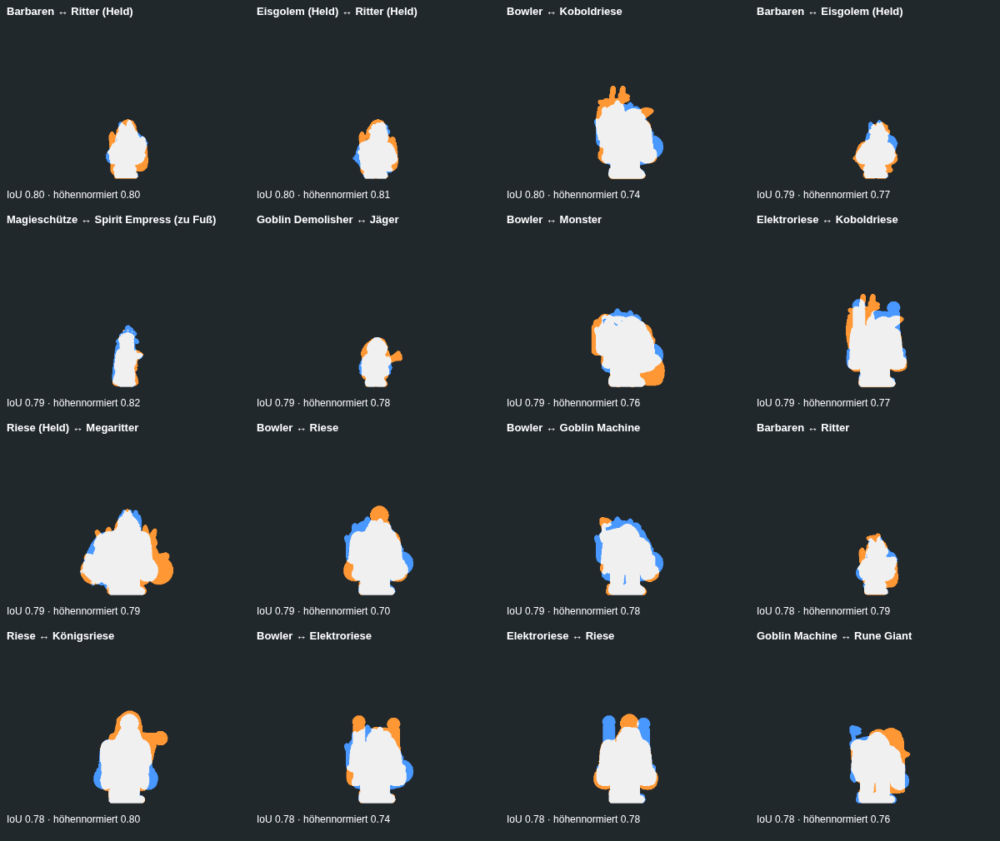
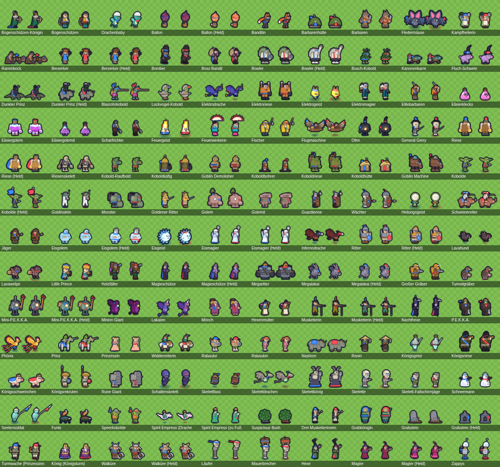
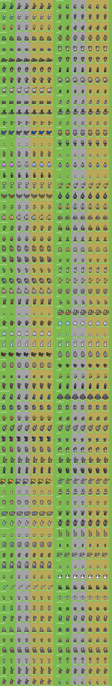

# Prüfergebnis der Figuren

Erzeugt von `npm run check:characters` (tools/characters/check.mjs) am 2026-10-12. Schwellen: `CHECK` in tools/characters/system.mjs.

| Prüfung | Ergebnis | Fehler | Hinweise |
|---|---|---|---|
| contact | bestanden | 0 | 0 |
| silhouette | bestanden mit Hinweisen | 0 | 283 |
| color | bestanden mit Hinweisen | 0 | 11 |
| small | bestanden mit Hinweisen | 0 | 6 |
| team | bestanden | 0 | 0 |
| anim | bestanden mit Hinweisen | 0 | 34 |
| perf | **nicht bestanden** | 2 | 0 |
| review | bestanden mit Hinweisen | 0 | 9 |

## 1. Contact Sheet

 – 130 Figuren, 7,8 MB.

## 2. Silhouetten

Ruhebild jeder Figur als Maske (Team Blau, vorn, 50 px pro Feld, Fußpunkte deckungsgleich), IoU aller 8385 Paare; zusätzlich höhennormiert (150 px hoch). Fehler ab IoU 0,80, Hinweis ab 0,70 bzw. höhennormiert ab 0,85. Verwandte Paare (29) zählen nicht, dürfen aber nicht deckungsgleich sein (Fehler ab 0,97).

Mittelwert 0,422. Verteilung: 0,0–0,1: 109 · 0,1–0,2: 637 · 0,2–0,3: 1259 · 0,3–0,4: 1810 · 0,4–0,5: 1829 · 0,5–0,6: 1455 · 0,6–0,7: 990 · 0,7–0,8: 285 · 0,8–0,9: 6 · 0,9–1,0: 5.

| Paar (unverwandt) | IoU | höhennormiert |
|---|---|---|
| Barbaren ↔ Ritter (Held) | 0,80 | 0,80 |
| Eisgolem (Held) ↔ Ritter (Held) | 0,80 | 0,81 |
| Bowler ↔ Koboldriese | 0,80 | 0,74 |
| Barbaren ↔ Eisgolem (Held) | 0,79 | 0,77 |
| Magieschütze ↔ Spirit Empress (zu Fuß) | 0,79 | 0,82 |
| Goblin Demolisher ↔ Jäger | 0,79 | 0,78 |
| Bowler ↔ Monster | 0,79 | 0,76 |
| Elektroriese ↔ Koboldriese | 0,79 | 0,77 |
| Riese (Held) ↔ Megaritter | 0,79 | 0,79 |
| Bowler ↔ Riese | 0,79 | 0,70 |
| Bowler ↔ Goblin Machine | 0,79 | 0,78 |
| Barbaren ↔ Ritter | 0,78 | 0,79 |

**Hinweise:**

- barbarians ~ knight-hero: IoU 0.80, höhennormiert 0.80
- ice-golem-hero ~ knight-hero: IoU 0.80, höhennormiert 0.81
- bowler ~ goblin-giant: IoU 0.80, höhennormiert 0.74
- barbarians ~ ice-golem-hero: IoU 0.79, höhennormiert 0.77
- magic-archer ~ spirit-empress-ground: IoU 0.79, höhennormiert 0.82
- goblin-demolisher ~ hunter: IoU 0.79, höhennormiert 0.78
- bowler ~ goblinstein-monster: IoU 0.79, höhennormiert 0.76
- electro-giant ~ goblin-giant: IoU 0.79, höhennormiert 0.77
- giant-hero ~ mega-knight: IoU 0.79, höhennormiert 0.79
- bowler ~ giant: IoU 0.79, höhennormiert 0.70
- bowler ~ goblin-machine: IoU 0.79, höhennormiert 0.78
- barbarians ~ knight: IoU 0.78, höhennormiert 0.79
- giant ~ royal-giant: IoU 0.78, höhennormiert 0.80
- bowler ~ electro-giant: IoU 0.78, höhennormiert 0.74
- electro-giant ~ giant: IoU 0.78, höhennormiert 0.78
- goblin-machine ~ rune-giant: IoU 0.78, höhennormiert 0.76
- giant ~ rune-giant: IoU 0.78, höhennormiert 0.69
- ice-golem ~ rascal-boy: IoU 0.78, höhennormiert 0.76
- barbarians ~ ice-golem: IoU 0.77, höhennormiert 0.74
- berserker-hero ~ elite-barbarians: IoU 0.77, höhennormiert 0.66
- … 263 weitere (siehe char_check.json)

## 3. Farben (CIEDE2000)

Geplante Farben: 0 Verstöße gegen die Farbregeln, 0 gegen die Matrix-Regeln. Gerendert: Anteil der Eigenfarbfläche (ohne Kontur und Teamzonen), der höchstens ΔE2000 10 von der Materialrampe der Haupt- bzw. Akzentfarbe entfernt ist (Fehler unter 15,0 % Hauptfarbe, Hinweis unter 1,0 % Akzent).

| engste unverwandte Farbschemata | Schema-Abstand |
|---|---|
| Ballon ↔ Mönch | 8,4 |
| Kobolde ↔ Skelettfass | 9,2 |
| Riese ↔ Koboldbohrer | 9,3 |
| Eisgeist ↔ Schneemann | 10,0 |
| Ballon ↔ Magier | 10,2 |
| Feuergeist ↔ Speerkobolde | 10,2 |

Median Hauptfarb-Anteil 62,0 %, Akzent 9,1 %.

**Hinweise:**

- balloon-hero: Akzentfarbe nur 0,7 %
- bomber: Akzentfarbe nur 0,3 %
- cursed-hog: Akzentfarbe nur 0,8 %
- dark-prince-hero: Akzentfarbe nur 0,4 %
- electro-giant: Akzentfarbe nur 0,0 %
- electro-spirit: Akzentfarbe nur 0,0 %
- flying-machine: Akzentfarbe nur 0,0 %
- night-witch: Akzentfarbe nur 0,7 %
- rune-giant: Akzentfarbe nur 0,3 %
- wall-breaker-runner: Akzentfarbe nur 0,0 %
- witch: Akzentfarbe nur 0,0 %

## 4. 40-px-Test

Jede Figur 40 px hoch auf Arena-Gras, einmal mit und einmal ohne ihre Signature-Teile (`data-sig`). Gezählt werden Pixel, die sich sichtbar ändern (ΔE76 > 12). Fehler unter 20 px, Hinweis unter 4,0 % der Figurfläche. Median 22,0 %.

**Hinweise:**

- barbarian-hut: Signature-Fläche 3,4 % der Figur
- bowler: Signature-Fläche 1,9 % der Figur
- bowler-hero: Signature-Fläche 2,6 % der Figur
- giant-skeleton: Signature-Fläche 3,5 % der Figur
- goblin-machine: Signature-Fläche 3,3 % der Figur
- rascal-girl: Signature-Fläche 3,9 % der Figur

## 5. Team-Test

Ruhebild in Blau und Rot (52 px pro Feld = Spielgröße bei 2-facher Pixeldichte). Teamfläche = Pixel, die sich zwischen Blau und Rot unterscheiden (ΔE76 > 8); erlaubt 3,0 %–25,0 %, größte 23,0 %. Teamsymbol (Kreis/Dreieck) muss mit mindestens 8 px sichtbar sein, sich in Graustufen auf ebenso vielen Pixeln unterscheiden (Blau und Rot sind fast gleich hell, die Form trägt die Information) und im Farbenblind-Modus um mindestens 1,4× wachsen. Fehlsichtigkeit (Machado 2009: Protanopie, Deuteranopie, Tritanopie): Anteil der Teamfläche, der unterscheidbar bleibt (≥ 60,0 %).

## 6. Animationen

8760 Bilder aller Zustände (Basis, Evo, Formen) so gebacken wie im Spiel (Qualität Hoch), dazu je Zustand 64 fein abgetastete Posen (81575 insgesamt, ohne Rastern). Geprüft: kein deckendes Pixel am Bildrand (abgeschnitten); Unstetigkeiten – Schritte, in denen ein Teil um mehr als 6,0 % der Ruhehöhe wandert, werden per Halbierung eingegrenzt, bleibt dort mehr als 4,0 %, springt das Teil (bei Schleifen auch über das Ende); Einstieg aus der Ruhepose (Hinweis ab 40,0 %); Füße der Bodenfiguren: in Ruhe am Fußpunkt (± 6 mu), in keinem Zustand mehr als 6 mu tiefer, in Ruhe und beim Laufen mit Bodenkontakt (höchstens 4 mu darüber).

**Hinweise:**

- archer-queen: Bodenkontakt -17 mu neben dem Fußpunkt
- bandit charge: Einstieg aus der Ruhe, Teil „tailScarf“ 40,7 % der Höhe entfernt
- battle-healer stun: Einstieg aus der Ruhe, Teil „pestle“ 41,0 % der Höhe entfernt
- battle-ram: Bodenkontakt -19 mu neben dem Fußpunkt
- bowler-hero walk: Einstieg aus der Ruhe, Teil „handF“ 75,2 % der Höhe entfernt
- bowler-hero charge: Einstieg aus der Ruhe, Teil „handF“ 77,5 % der Höhe entfernt
- bowler-hero attack: Einstieg aus der Ruhe, Teil „handF“ 76,5 % der Höhe entfernt
- bowler-hero hit: Einstieg aus der Ruhe, Teil „handF“ 76,5 % der Höhe entfernt
- bowler-hero death: Einstieg aus der Ruhe, Teil „handF“ 76,5 % der Höhe entfernt
- bowler-hero stun: Einstieg aus der Ruhe, Teil „handF“ 73,4 % der Höhe entfernt
- bowler-hero sleep: Einstieg aus der Ruhe, Teil „handF“ 76,3 % der Höhe entfernt
- bowler-hero ability: Einstieg aus der Ruhe, Teil „boulder“ 97,9 % der Höhe entfernt
- dart-goblin stun: Einstieg aus der Ruhe, Teil „pipe“ 56,2 % der Höhe entfernt
- executioner stun: Einstieg aus der Ruhe, Teil „axe“ 47,3 % der Höhe entfernt
- firecracker stun: Einstieg aus der Ruhe, Teil „rockets“ 59,6 % der Höhe entfernt
- fisherman stun: Einstieg aus der Ruhe, Teil „rod“ 42,6 % der Höhe entfernt
- guardienne stun: Einstieg aus der Ruhe, Teil „halberd“ 41,0 % der Höhe entfernt
- guards stun: Einstieg aus der Ruhe, Teil „spear“ 51,2 % der Höhe entfernt
- ice-wizard stun: Einstieg aus der Ruhe, Teil „staff“ 51,2 % der Höhe entfernt
- ice-wizard-hero stun: Einstieg aus der Ruhe, Teil „staff“ 50,5 % der Höhe entfernt
- mini-pekka stun: Einstieg aus der Ruhe, Teil „wrench“ 55,7 % der Höhe entfernt
- mini-pekka-hero stun: Einstieg aus der Ruhe, Teil „wrench“ 55,9 % der Höhe entfernt
- musketeer: Bodenkontakt 41 mu neben dem Fußpunkt
- musketeer-hero: Bodenkontakt 41 mu neben dem Fußpunkt
- night-witch stun: Einstieg aus der Ruhe, Teil „staff“ 51,7 % der Höhe entfernt
- princess stun: Einstieg aus der Ruhe, Teil „midString“ 45,7 % der Höhe entfernt
- skeletrooper stun: Einstieg aus der Ruhe, Teil „spear“ 59,9 % der Höhe entfernt
- tower-guard stun: Einstieg aus der Ruhe, Teil „bow“ 61,5 % der Höhe entfernt
- tower-king charge: Einstieg aus der Ruhe, Teil „mantleHem“ 43,1 % der Höhe entfernt
- valkyrie: Bodenkontakt 21 mu neben dem Fußpunkt
- … 4 weitere (siehe char_check.json)

## 7. Performance

Szene: 60 Einheiten aus 60 verschiedenen Figuren in drei Wellen, dazu 12 Zauber, 14 s, als Snapshot-Folge im echten Client abgespielt (tools/characters/check-perf.mjs).

| Stand | Profil | FPS | p95 | schlechtester Frame | Long Tasks | automatische Qualität am Ende |
|---|---|---|---|---|---|---|
| vorher | desktop-1440x900 (CPU 1×) | 43 | 33 ms | 200 ms | 1 | DPR voll, Effekte 0,4, Figuren –, Absenkungen – (kein Zähler) |
| vorher | phone-390x844 (CPU 4×) | 13 | 117 ms | 1283 ms | 489 | DPR 1, Effekte 0,4, Figuren –, Absenkungen – (kein Zähler) |
| nachher | desktop-1440x900 (CPU 1×) | 42 | 33 ms | 183 ms | 11 | DPR voll, Effekte 0,4, Figuren medium, Absenkungen 5 |
| nachher | phone-390x844 (CPU 4×) | 14 | 100 ms | 1150 ms | 430 | DPR 1, Effekte 0,4, Figuren low, Absenkungen 19 |

Lasttest der automatischen Qualität (CPU 8×): 6 FPS, 20 Absenkungen, Ende: DPR 1, Effekte 0,4, Figuren low.

**Fehler:**

- Desktop 42 FPS < 55
- Handy (CPU 4× gedrosselt) 14 FPS < 30

## 8. Eigenständigkeits-Review

Ein Satz pro Figur aus Brief und Matrix, dazu der nächste unverwandte Nachbar nach Silhouette und Farbe. **generisch?** heißt: Die Silhouette liegt nah an einer anderen Figur (IoU ≥ 0,70) und zusätzlich sind die Farben ähnlich (Schema < 15) oder die Signature ist bei 40 px schwach. Die gleiche Familie allein zählt nicht, Familien teilen ihre Grundform absichtlich.

| Figur | Satz | nächste Silhouette | nächstes Farbschema | Markierung |
|---|---|---|---|---|
| Bogenschützen-Königin | Bogenschützen-Königin (Hochgewachsen, L): Mondsichel-Armbrust; übertrieben: steife Spitzenkrause bis über die Ohren; kühl und überlegen, hochgezogene Augenbraue. | Barbaren (0,72) | Grabkönigin (11,0) | Silhouette wie Barbaren (IoU 0,72) |
| Bogenschützen | Bogenschützen (Schlank, S): Fächerköcher wie ein Pfauenrad; übertrieben: Pfeilfächer breiter als die Schultern; sportlich und eifrig, zwinkern beim Zielen. | Elixiergolemit (0,74) | Fischer (10,4) | Silhouette wie Elixiergolemit (IoU 0,74) |
| Drachenbaby | Drachenbaby (Geflügelt, M): Eierschalen-Mütze; übertrieben: Kopf so groß wie der Bauch, Stummelflügel; verspielt und neugierig. | Berserker (Held) (0,74) | Seelensoldat (11,8) | Silhouette wie Berserker (Held) (IoU 0,74) |
| Ballon | Ballon (Schwebend, XL): Zwiebelkuppel-Ballon aus Flicken mit Messingpropeller; übertrieben: Gnom-Pilot mit Riesen-Hörrohr; schadenfroh kichernder Pilot. | Nachthexe (0,66) | Mönch (8,4) |  |
| Ballon (Held) | Ballon (Held) (Schwebend, XL): Skelett-Kadett mit Fallschirm im Korb; übertrieben: Fallschirm-Ausleger am Korb; Pilot und Kadett salutieren. | Holzfäller (0,65) | Banditin (13,6) |  |
| Banditin | Banditin (Geduckt, M): Fuchsohr-Kapuze mit Fuchsschwanz-Schal; übertrieben: buschiger Schwanzschal; verschlagen, grinst. | Goblin Demolisher (0,68) | Ballon (Held) (13,6) |  |
| Barbarenhütte | Barbarenhütte (Bauwerk, XL): Langhaus mit Wolfsschädel über dem Tor; übertrieben: tief heruntergezogenes Grassodendach; rauchend und lärmend. | Elixiergolem (0,75) | Bowler (14,4) | **generisch?** Silhouette wie Elixiergolem (IoU 0,75); Signature bei 40 px schwach (3,4 %) |
| Barbaren | Barbaren (Breit, M): Wolfskopf-Kapuze mit offenem Maul; übertrieben: gewaltige umwickelte Unterarme; laut und draufgängerisch, brüllt. | Ritter (Held) (0,80) | Koboldhütte (13,3) | Silhouette wie Ritter (Held) (IoU 0,80, gleiche Familie) |
| Fledermäuse | Fledermäuse (Geflügelt, XS): Lindenblatt-Ohren und ein einzelner Zahn; übertrieben: Ohren größer als der Körper; hibbelig, quietscht. | Suspicious Bush (0,68) | Schattenskelett (20,2) |  |
| Kampfheilerin | Kampfheilerin (Breit, M): Mörser-Rucksack mit Kräutern; übertrieben: Riesenstößel als Keule; resolut und fürsorglich. | Golemit (0,77) | Turmwache (Prinzessinnenturm) (15,3) | Silhouette wie Golemit (IoU 0,77) |
| Rammbock | Rammbock (Fahrzeug, M): geschnitzter Widderkopf mit eisernen Spiralhörnern am Stamm; übertrieben: riesige eiserne Spiralhörner; zwei schnaufende Schieber, entschlossen. | Kanonenkarre (0,56) | Kobold-Raufbold (13,9) |  |
| Berserker | Berserker (Keil, M): Kochtopf-Helm mit Henkeln wie Hörner; übertrieben: zwei riesige Bratpfannen; wild, lacht gackernd. | Magier (0,75) | Banditin (16,1) | Silhouette wie Magier (IoU 0,75) |
| Berserker (Held) | Berserker (Held) (Keil, M): Bärenfell-Umhang mit Bärenkopf-Kapuze; übertrieben: Bärengeist-Schemen bei der Wut; wild, brüllt wie ein Bär. | Elitebarbaren (0,77) | Rammbock (17,1) | Silhouette wie Elitebarbaren (IoU 0,77, gleiche Familie) |
| Bomber | Bomber (Kugelig, S): Zylinder voller Bomben; übertrieben: Zylinder höher als der Körper; kichernd und schelmisch. | Goblin Demolisher (0,73) | Skelettfass (15,7) | Silhouette wie Goblin Demolisher (IoU 0,73, gleiche Familie) |
| Boss Bandit | Boss Bandit (Keil, M): Beutesack über der Schulter, aus dem Münzen fallen; übertrieben: riesiger Silberfuchs-Kragen; selbstsicher und arrogant. | Elektromagier (0,77) | Mönch (11,5) | Silhouette wie Elektromagier (IoU 0,77) |
| Bowler | Bowler (Massig, XL): winziger Melonenhut auf riesigem Kopf; übertrieben: Moos-Rücken eines Steintrolls; gemütlich, konzentriert wie beim Kegeln. | Koboldriese (0,80) | Barbarenhütte (14,4) | **generisch?** Silhouette wie Koboldriese (IoU 0,80, gleiche Familie); Signature bei 40 px schwach (1,9 %) |
| Bowler (Held) | Bowler (Held) (Massig, XL): Krone aus Kegeln; übertrieben: Kegelkrone; triumphierender Kegelkönig. | Elektroriese (0,75) | Zappys (12,7) | **generisch?** Silhouette wie Elektroriese (IoU 0,75, gleiche Familie); Signature bei 40 px schwach (2,6 %) |
| Busch-Kobold | Busch-Kobold (Geduckt, S): Tarnanzug aus Zweigen und Blättern; übertrieben: Blätterschopf wie ein Strauch; verschwörerisch, flüstert. | Lockvogel-Kobold (0,75) | Koboldriese (13,8) | Silhouette wie Lockvogel-Kobold (IoU 0,75) |
| Kanonenkarre | Kanonenkarre (Fahrzeug, M): Hechtkopf-Kanonenrohr; übertrieben: Fischmaul-Mündung mit Zähnen; Kanonier mit Ohrenschützern, pfeift. | Rammbock (0,56) | Mini-P.E.K.K.A. (Held) (10,9) |  |
| Fluch-Schwein | Fluch-Schwein (Vierbeinig, XS): Mini-Hexenhut mit Fluchsternchen; übertrieben: Fluchrauch aus den Ohren; verwirrt und grantig. | Königsschweinchen (0,75) | Megalakai (Held) (24,0) | Silhouette wie Königsschweinchen (IoU 0,75, gleiche Familie) |
| Dunkler Prinz | Dunkler Prinz (Reiter, L): gepanzerter Waran als Reittier; übertrieben: Waran-Krallen und Stachelschulter; düster und arrogant. | Koboldkäfig (0,61) | Magieschütze (15,3) |  |
| Dunkler Prinz (Held) | Dunkler Prinz (Held) (Reiter, XL): Sichelmond-Krone über dem Visier; übertrieben: reitet ein gepanzertes Nashorn; eiskalt und siegesgewiss. | Widderreiterin (0,72) | Drei Musketierinnen (16,9) | Silhouette wie Widderreiterin (IoU 0,72, gleiche Familie) |
| Blasrohrkobold | Blasrohrkobold (Geduckt, S): Blasrohr doppelt so lang wie er selbst; übertrieben: Blasrohr; hibbelig, schielt beim Zielen. | Skelett-Fallschirmjäger (0,65) | Boss Bandit (16,8) |  |
| Lockvogel-Kobold | Lockvogel-Kobold (Winzig, S): Lockente-Kostüm mit Holzschnabel; übertrieben: Entenschnabel-Kapuze; albern, quakt. | Busch-Kobold (0,75) | Flugmaschine (12,9) | Silhouette wie Busch-Kobold (IoU 0,75) |
| Elektrodrache | Elektrodrache (Geflügelt, M): Blitzableiter-Horn mit Kupferspule; übertrieben: statisch abstehende Mähne; nervös, zuckt. | Skelettdrachen (0,74) | Magieschütze (10,8) | Silhouette wie Skelettdrachen (IoU 0,74, gleiche Familie) |
| Elektroriese | Elektroriese (Massig, XL): Teslaspulen als Schulterpolster; übertrieben: riesige Gummihandschuhe; grimmig, knurrt durch das Schweißervisier. | Koboldriese (0,79) | Golemit (21,0) | Silhouette wie Koboldriese (IoU 0,79, gleiche Familie) |
| Elektrogeist | Elektrogeist (Schwebend, XS): Steckerzinken als Ohren; übertrieben: Zickzack-Schwanz; aufgekratzt. | Feuergeist (0,71) | Großer Gräber (21,7) | Silhouette wie Feuergeist (IoU 0,71, gleiche Familie) |
| Elektromagier | Elektromagier (Hochgewachsen, M): Rucksack aus Blitzflaschen mit Kupferbügeln; übertrieben: Kupferspulen-Handschuhe; exzentrisch, grinst manisch. | Boss Bandit (0,77) | Grabkönigin (12,4) | Silhouette wie Boss Bandit (IoU 0,77) |
| Elitebarbaren | Elitebarbaren (Keil, M): Bärenschädel-Schulterpanzer; übertrieben: Schultern doppelt so breit wie die Hüfte; angeberisch, grinst überlegen. | Berserker (Held) (0,77) | Koboldkäfig (13,2) | Silhouette wie Berserker (Held) (IoU 0,77, gleiche Familie) |
| Elixierklecks | Elixierklecks (Amorph, XS): Korkhütchen auf dem Klecks; übertrieben: riesige glänzende Augen; quietschfidel. | Eisgeist (0,71) | Rabaukin (24,2) | Silhouette wie Eisgeist (IoU 0,71) |
| Elixiergolem | Elixiergolem (Massig, XL): Glasbauch voller blubbernder Flüssigkeit; übertrieben: Korken als Kopf; tumb-fröhlich, blubbert. | Riese (0,76) | Guardienne (23,7) | Silhouette wie Riese (IoU 0,76, gleiche Familie) |
| Elixiergolemit | Elixiergolemit (Kugelig, M): Erlenmeyerkolben-Körper mit Stopfen; übertrieben: Glasbauch mit Messskala; aufgeregt. | König (Königsturm) (0,76) | Guardienne (20,1) | Silhouette wie König (Königsturm) (IoU 0,76) |
| Scharfrichter | Scharfrichter (Hochgewachsen, L): Sichelaxt an einer Kette; übertrieben: Eisenmaske mit zwei runden Gucklöchern; stoisch, summt unheimlich. | Magieschütze (0,71) | Infernodrache (14,8) | Silhouette wie Magieschütze (IoU 0,71) |
| Feuergeist | Feuergeist (Schwebend, XS): Kerzenwachs-Körper mit Flammenhaar; übertrieben: Flammenhaar höher als der Körper; übermütig. | Elektrogeist (0,71) | Speerkobolde (10,2) | Silhouette wie Elektrogeist (IoU 0,71, gleiche Familie) |
| Feuerwerkerin | Feuerwerkerin (Schlank, S): Papierschirm, dessen Speichen Raketen sind; übertrieben: Wunderkerzen im Haarknoten; aufgekratzt, lacht laut. | Goblinstein (0,67) | Eisgolem (26,3) |  |
| Fischer | Fischer (Breit, M): Angelrute mit Riesen-Blinker; übertrieben: Südwester mit breiter Krempe; knurrig-gemütlich, Pfeife im Mund. | Golemit (0,74) | Bogenschützen (10,4) | Silhouette wie Golemit (IoU 0,74) |
| Flugmaschine | Flugmaschine (Mechanisch, M): Schlagflügel aus Segeltuch mit Holzrippen; übertrieben: Flügelspannweite doppelt so groß wie die Höhe; Pilotin mit Zunge im Mundwinkel. | Infernodrache (0,61) | Widderreiterin (10,8) |  |
| Ofen | Ofen (Mechanisch, L): glühende Ofenklappe als Bauch; übertrieben: Ofenrohr als hoher Hut; brummig und hitzköpfig. | Ritter (Held) (0,74) | Lavahund (12,5) | Silhouette wie Ritter (Held) (IoU 0,74) |
| General Gerry | General Gerry (Winzig, S): Zweispitz mit Federbusch; übertrieben: goldene Epauletten breiter als der Schädel; kommandierend, zeigt mit dem Säbel. | Rabaukin (0,73) | Ofen (13,3) | Silhouette wie Rabaukin (IoU 0,73, gleiche Familie) |
| Riese | Riese (Massig, XL): Bommelmütze mit Riesenbommel; übertrieben: riesige Arbeitshandschuhe; gutmütig und schnaufend. | Bowler (0,79) | Koboldbohrer (9,3) | Silhouette wie Bowler (IoU 0,79, gleiche Familie) |
| Riese (Held) | Riese (Held) (Massig, XL): Erntekrone aus Weizenähren; übertrieben: Steppdecken-Umhang; stolzer Erntekönig. | Megaritter (0,79) | Speerkobolde (10,9) | Silhouette wie Megaritter (IoU 0,79, gleiche Familie) |
| Riesenskelett | Riesenskelett (Massig, XL): Uhrwerk-Bombe im Brustkorb; übertrieben: Riesenfäuste aus Fingerknochen; dröhnend lachend. | Riese (0,73) | Flugmaschine (15,0) | **generisch?** Silhouette wie Riese (IoU 0,73, gleiche Familie); Signature bei 40 px schwach (3,5 %) |
| Kobold-Raufbold | Kobold-Raufbold (Keil, M): gesprengte Handschellen mit Kettenresten; übertrieben: Fäuste groß wie der Kopf; wütend und befreit, schnaubt. | Jäger (0,76) | Rammbock (13,9) | Silhouette wie Jäger (IoU 0,76) |
| Koboldkäfig | Koboldkäfig (Bauwerk, L): vergoldeter Vogelkäfig mit rüttelndem Raufbold; übertrieben: riesiges Vorhängeschloss; wackelnd, der Gefangene tobt. | Grabstein (Held) (0,77) | Elitebarbaren (13,2) | Silhouette wie Grabstein (Held) (IoU 0,77, gleiche Familie) |
| Goblin Demolisher | Goblin Demolisher (Kugelig, M): Bullaugen-Helm am gepolsterten Bombenanzug; übertrieben: kugelrunder Polsteranzug; fröhlich-leichtsinnig. | Jäger (0,79) | Riese (Held) (12,4) | Silhouette wie Jäger (IoU 0,79) |
| Koboldbohrer | Koboldbohrer (Bauwerk, XL): Bohrturm mit Schraubenspitze und Kobold-Fahrer; übertrieben: Riesenschraube; rattert und ruckelt. | Magieschütze (0,70) | Riese (9,3) | Silhouette wie Magieschütze (IoU 0,70) |
| Koboldriese | Koboldriese (Massig, XL): Fass-Krähennest mit zwei Speerkobolden; übertrieben: Riesenohren mit Ohrringen wie Fassreifen; tumb und gutmütig, grinst schief. | Bowler (0,80) | Busch-Kobold (13,8) | Silhouette wie Bowler (IoU 0,80, gleiche Familie) |
| Koboldhütte | Koboldhütte (Bauwerk, XL): schiefe Flickwerk-Hütte mit Kürbis-Schornstein; übertrieben: krummer Kürbisschornstein; knarzend, Kobolde gucken heraus. | Barbarenhütte (0,74) | Barbaren (13,3) | Silhouette wie Barbarenhütte (IoU 0,74, gleiche Familie) |
| Goblin Machine | Goblin Machine (Mechanisch, XL): Kolbenfaust mit Dampfzylinder; übertrieben: Kolbenfaust größer als der Pilot; Pilot jauchzt, Maschine stampft. | Bowler (0,79) | Golemit (15,5) | **generisch?** Silhouette wie Bowler (IoU 0,79); Signature bei 40 px schwach (3,3 %) |
| Kobolde | Kobolde (Winzig, S): geschliffener Löffeldolch; übertrieben: Riesenohren mit Goldringen; frech und gierig. | Skelette (0,72) | Skelettfass (9,2) | Silhouette wie Skelette (IoU 0,72, gleiche Familie) |
| Kobolde (Held) | Kobolde (Held) (Winzig, S): Brigade-Banner auf dem Rücken; übertrieben: Banner doppelt so hoch wie der Kobold; kriegerisch-frech, Kriegsbemalung. | Speerkobolde (0,60) | Ballon (13,9) |  |
| Goblinstein | Goblinstein (Schlank, M): Fernsteuerkasten mit Blitzantenne; übertrieben: Schweißerbrille mit dicken Gläsern; größenwahnsinnig, lacht irre. | Eismagier (Held) (0,77) | Eismagier (11,4) | Silhouette wie Eismagier (Held) (IoU 0,77) |
| Monster | Monster (Massig, XL): Rücken-Akku mit Kabeln zu Kupferklemmen am Hals; übertrieben: Flickenkörper mit ungleich großen Armen; sanftes Monster, brummt Wiegenlieder. | Bowler (0,79) | Koboldriese (13,8) | Silhouette wie Bowler (IoU 0,79, gleiche Familie) |
| Goldener Ritter | Goldener Ritter (Schlank, L): Strahlenkranz-Helmzier; übertrieben: Strahlenkranz wie eine Sonne hinter dem Kopf; eitel und strahlend, posiert. | Magieschütze (0,75) | Riese (Held) (20,4) | Silhouette wie Magieschütze (IoU 0,75, gleiche Familie) |
| Golem | Golem (Massig, XXL): Bäumchen mit Vogelnest auf der Schulter; übertrieben: Felsfäuste so groß wie der Rumpf; uralt und träge, brummt. | Megaritter (0,76) | Prinzessin (12,9) | Silhouette wie Megaritter (IoU 0,76, gleiche Familie) |
| Golemit | Golemit (Kugelig, M): halbe Säule als Rumpf mit Kapitell-Kopf; übertrieben: abgebrochenes Säulenkapitell; trotzig. | Kampfheilerin (0,77) | Goblin Machine (15,5) | Silhouette wie Kampfheilerin (IoU 0,77) |
| Guardienne | Guardienne (Keil, L): echte Holztür als Schild; übertrieben: Tür-Schild mit Klinke und Briefschlitz; wachsam, beschützend, wortkarg. | Ritter (0,68) | Magieschütze (Held) (11,4) |  |
| Wächter | Wächter (Winzig, S): Sargdeckel-Schild; übertrieben: Sargdeckel länger als der Wächter; steif und pflichtbewusst, salutieren. | Little Prince (0,69) | Tunnelgräber (16,8) |  |
| Heilungsgeist | Heilungsgeist (Schwebend, XS): Pusteblumen-Kopf; übertrieben: Samenschirmchen; sanft und kichernd. | Elektrogeist (0,69) | Elektrogeist (23,2) |  |
| Schweinereiter | Schweinereiter (Reiter, L): Karottenangel vor der Schweineschnauze; übertrieben: Rennbrille und flatternde Jockeymütze; übermütig, jauchzt. | Dunkler Prinz (Held) (0,70) | Koboldhütte (13,7) | Silhouette wie Dunkler Prinz (Held) (IoU 0,70, gleiche Familie) |
| Jäger | Jäger (Breit, M): Donnerbüchse mit Trichtermündung; übertrieben: Biberfellmütze mit Schwanz; brummig, kneift ein Auge zu. | Goblin Demolisher (0,79) | Scharfrichter (16,1) | Silhouette wie Goblin Demolisher (IoU 0,79) |
| Eisgolem | Eisgolem (Kugelig, M): eingefrorener Fisch im Bauch; übertrieben: kugelrunder Eisbauch; verschlafen-friedlich. | Rabauke (0,78) | Königsgeist (18,8) | Silhouette wie Rabauke (IoU 0,78) |
| Eisgolem (Held) | Eisgolem (Held) (Kugelig, L): Eiskrone mit Schneeflocken-Zacken; übertrieben: Schneesturm-Wirbel um den Bauch; majestätisch-verschlafen. | Ritter (Held) (0,80) | Zappys (13,5) | Silhouette wie Ritter (Held) (IoU 0,80) |
| Eisgeist | Eisgeist (Winzig, XS): Eiskristall-Stacheln wie ein Igel; übertrieben: Stachelkranz; kichernd, kalt. | Elixierklecks (0,71) | Schneemann (10,0) | Silhouette wie Elixierklecks (IoU 0,71) |
| Eismagier | Eismagier (Dreieckig, M): Schneekugel-Stab mit Winterlandschaft; übertrieben: Eiszapfen-Bart bis zum Gürtel; gelassen und schusselig. | Goblinstein (0,75) | Goblinstein (11,4) | **generisch?** Silhouette wie Goblinstein (IoU 0,75); ähnliche Farben wie Goblinstein (Schema 11,4) |
| Eismagier (Held) | Eismagier (Held) (Dreieckig, M): kleiner Schneemann-Gehilfe auf der Schulter; übertrieben: Schneekugel-Stab mit Schneemann darin; großväterlich, lacht. | Goblinstein (0,77) | Eisgeist (12,8) | Silhouette wie Goblinstein (IoU 0,77) |
| Infernodrache | Infernodrache (Geflügelt, L): Brennglas in Messingfassung vor dem Maul; übertrieben: Brennglas so groß wie der Kopf; brütend und konzentriert. | Elektrodrache (0,68) | Lavawelpe (12,6) |  |
| Ritter | Ritter (Breit, M): Zinnenschild in Burgturm-Form; übertrieben: Zinnenschild fast so hoch wie er selbst; stur und pflichtbewusst, Pflaster quer über der Nase. | Barbaren (0,78) | Walküre (18,9) | Silhouette wie Barbaren (IoU 0,78, gleiche Familie) |
| Ritter (Held) | Ritter (Held) (Breit, M): Löwenmähnen-Kragen mit Heldenumhang; übertrieben: Zinnenschild mit goldener Krone; herausfordernd, ruft zum Kampf. | Barbaren (0,80) | Königsschweinchen (12,6) | Silhouette wie Barbaren (IoU 0,80, gleiche Familie) |
| Lavahund | Lavahund (Schwebend, XXL): Vulkankrater auf dem Rücken; übertrieben: Basaltplatten-Panzer; hechelnd und gutmütig. | Großer Gräber (0,64) | Ofen (12,5) |  |
| Lavawelpe | Lavawelpe (Geflügelt, XS): Glutkringel-Schwanz; übertrieben: riesige Welpenaugen; tapsig. | Fledermäuse (0,63) | Boss Bandit (12,4) |  |
| Little Prince | Little Prince (Winzig, S): viel zu große Krone, die über die Augen rutscht; übertrieben: Krone so breit wie der ganze Prinz; verwöhnt und ungeduldig, stampft. | General Gerry (0,72) | Drachenbaby (15,6) | Silhouette wie General Gerry (IoU 0,72, gleiche Familie) |
| Holzfäller | Holzfäller (Hochgewachsen, M): Holzkraxe mit Holzscheiten und Wutflasche; übertrieben: Bart voller Tannenzweige; hektisch und gutgelaunt. | Elektromagier (0,76) | Busch-Kobold (14,4) | Silhouette wie Elektromagier (IoU 0,76, gleiche Familie) |
| Magieschütze | Magieschütze (Schlank, M): Fernrohr-Bogen mit Messingvisier; übertrieben: Astrolabium-Hutkrempe mit Messingringen; verträumter Sterngucker, präzise. | Spirit Empress (zu Fuß) (0,79) | Elektrodrache (10,8) | Silhouette wie Spirit Empress (zu Fuß) (IoU 0,79) |
| Magieschütze (Held) | Magieschütze (Held) (Schlank, L): Sternbild-Mantel mit drei leuchtenden Pfeilsternen; übertrieben: Sternbilder, die sich auf dem Mantel bewegen; gerissen und verspielt. | Berserker (Held) (0,73) | Guardienne (11,4) | Silhouette wie Berserker (Held) (IoU 0,73) |
| Megaritter | Megaritter (Massig, XL): Glockenhelm, der beim Landen läutet; übertrieben: Kugelfäuste aus Gusseisen; wuchtig und selbstgefällig. | Riese (Held) (0,79) | Walküre (12,4) | Silhouette wie Riese (Held) (IoU 0,79, gleiche Familie) |
| Megalakai | Megalakai (Geflügelt, M): Steinbauch-Panzer mit Wasserspeier-Hörnern; übertrieben: kleine Flügel tragen einen schweren Steinbauch; grimmig, ächzt. | Kampfheilerin (0,70) | Grabstein (Held) (12,4) |  |
| Megalakai (Held) | Megalakai (Held) (Geflügelt, M): Visierhelm mit Heldenstern; übertrieben: Steinbauch mit Goldgravur; jagend, fixiert sein Ziel. | Berserker (Held) (0,71) | Grabstein (Held) (16,4) | Silhouette wie Berserker (Held) (IoU 0,71) |
| Großer Gräber | Großer Gräber (Breit, L): Bohrer statt rechtem Arm; übertrieben: Bauhelm mit greller Stirnlampe; polternd und zufrieden. | Mönch (0,73) | Koboldkäfig (14,3) | Silhouette wie Mönch (IoU 0,73, gleiche Familie) |
| Tunnelgräber | Tunnelgräber (Geduckt, M): Maulwurf-Schaufelkrallen; übertrieben: Krallen breiter als der Kopf; kurzsichtig und fleißig. | Fluch-Schwein (0,66) | Lavawelpe (13,6) |  |
| Mini-P.E.K.K.A. | Mini-P.E.K.K.A. (Mechanisch, M): Dampfpfeife auf dem Kessel, pfeift beim Schlag; übertrieben: Riesen-Rohrzange; eifrig und tollpatschig, ein großes Zyklopenauge. | Fischer (0,72) | Walküre (10,2) | Silhouette wie Fischer (IoU 0,72) |
| Mini-P.E.K.K.A. (Held) | Mini-P.E.K.K.A. (Held) (Mechanisch, M): Pfannkuchen-Turm auf dem Rücken mit Sirupflasche; übertrieben: Pfannkuchen-Stapel mit drei Füllleisten; verfressen und begeistert. | Golemit (0,71) | Kanonenkarre (10,9) | Silhouette wie Golemit (IoU 0,71) |
| Minion Giant | Minion Giant (Geflügelt, XL): Kehlsack, der sich vor dem Spucken aufbläht; übertrieben: genähte Laborflügel; träge und verfressen. | Ballon (Held) (0,64) | Magieschütze (15,4) |  |
| Lakaien | Lakaien (Geflügelt, S): einzelnes Stirnhorn und Pik-Schwanz; übertrieben: Pik-Schwanzspitze; frech und zappelig. | Speerkobolde (0,61) | Walküre (14,4) |  |
| Mönch | Mönch (Breit, L): Bronzegong auf dem Rücken; übertrieben: riesige Handflächen; heiter und unerschütterlich. | Ritter (0,75) | Ballon (8,4) | Silhouette wie Ritter (IoU 0,75, gleiche Familie) |
| Hexenmutter | Hexenmutter (Dreieckig, M): Kessel-Rucksack mit blubberndem Fluchsud; übertrieben: Lockenwickler unter dem Hut; resolute Hexen-Oma, droht mit der Kelle. | Rabauke (0,76) | Hexe (16,3) | Silhouette wie Rabauke (IoU 0,76) |
| Musketierin | Musketierin (Schlank, M): Musketengabel als Stütze; übertrieben: Muskete länger als sie selbst; ruhig und präzise, hebt eine Augenbraue. | Scharfrichter (0,67) | Skelett-Fallschirmjäger (13,5) |  |
| Musketierin (Held) | Musketierin (Held) (Schlank, L): Werkzeuggürtel mit Kurbel und Bauplan-Rolle; übertrieben: Federhut mit Orden; tüchtig, plant voraus. | Scharfrichter (0,66) | Suspicious Bush (11,5) |  |
| Nachthexe | Nachthexe (Hochgewachsen, L): Glockenturm-Hut, aus dem Fledermäuse fliegen; übertrieben: Hut mit kleinem Glockenstuhl; träge und spöttisch, gähnt. | Hexe (0,73) | Schattenskelett (13,6) | Silhouette wie Hexe (IoU 0,73, gleiche Familie) |
| P.E.K.K.A. | P.E.K.K.A. (Mechanisch, XL): Laternenkopf mit Flamme; übertrieben: Fallbeil-Schwert länger als der Rumpf; stumm und unaufhaltsam, die Flamme flackert vor Zorn. | Rune Giant (0,77) | Bomber (16,2) | Silhouette wie Rune Giant (IoU 0,77) |
| Phönix | Phönix (Geflügelt, M): Schleppfedern wie Flammenbänder; übertrieben: Flammenkamm; stolz und feurig. | Elektrodrache (0,57) | Großer Gräber (19,5) |  |
| Prinz | Prinz (Reiter, XL): Froschmaul-Stechhelm; übertrieben: Turnierlanze mit Spiralstreifen; edel und ungeduldig. | Rune Giant (0,61) | Kampfheilerin (16,8) |  |
| Prinzessin | Prinzessin (Dreieckig, S): Harfenbogen mit Saiten; übertrieben: Glockenkleid fast so breit wie hoch; verträumt, summt beim Zielen. | König (Königsturm) (0,76) | Golem (12,9) | Silhouette wie König (Königsturm) (IoU 0,76, gleiche Familie) |
| Widderreiterin | Widderreiterin (Reiter, L): Widder mit Doppelspiral-Hörnern und Glöckchen; übertrieben: Hörner groß wie Wagenräder; abenteuerlustig, ruft. | Dunkler Prinz (Held) (0,72) | Flugmaschine (10,8) | Silhouette wie Dunkler Prinz (Held) (IoU 0,72, gleiche Familie) |
| Rabauke | Rabauke (Breit, M): Rüstung aus Pappkartons mit Klebeband; übertrieben: Kochtopfdeckel als Schild; großspurig, Zahnlücke. | Eisgolem (0,78) | Flugmaschine (13,6) | Silhouette wie Eisgolem (IoU 0,78) |
| Rabaukin | Rabaukin (Winzig, S): Astgabel-Schleuder; übertrieben: Zöpfe, die beim Schießen hochfliegen; frech, Sommersprossen. | Skelett-Fallschirmjäger (0,75) | Ballon (Held) (22,6) | **generisch?** Silhouette wie Skelett-Fallschirmjäger (IoU 0,75, gleiche Familie); Signature bei 40 px schwach (3,9 %) |
| Nashorn | Nashorn (Vierbeinig, M): Doppelhorn mit Sichelmond-Schutzplatte; übertrieben: Panzerfalten wie Plattenrüstung; stur und schnaubend. | Dunkler Prinz (Held) (0,71) | Turmwache (Prinzessinnenturm) (13,0) | Silhouette wie Dunkler Prinz (Held) (IoU 0,71) |
| Ronin | Ronin (Schlank, M): tiefer Strohhut mit Papiersiegel; übertrieben: Hutkrempe breiter als die Schultern; ruhig und wachsam. | Berserker (Held) (0,76) | Skelett-Fallschirmjäger (11,5) | Silhouette wie Berserker (Held) (IoU 0,76) |
| Königsgeist | Königsgeist (Schwebend, M): schwebende Krone über leerem Helm; übertrieben: leerer Helm, aus dem Licht scheint; melancholisch, seufzt. | Drachenbaby (0,69) | Eisgolem (Held) (16,5) |  |
| Königsriese | Königsriese (Massig, XL): hohe Bärenfellmütze der Leibgarde; übertrieben: Schulterkanone mit Löwenmaul-Mündung; streng und stolz, Schnurrbart zuckt. | Riese (0,78) | Ronin (15,7) | Silhouette wie Riese (IoU 0,78, gleiche Familie) |
| Königsschweinchen | Königsschweinchen (Vierbeinig, XS): Minikrone zwischen den Ohren; übertrieben: Schweineschnauze groß wie der Kopf; quiekend und stolz. | Fluch-Schwein (0,75) | Ritter (Held) (12,6) | Silhouette wie Fluch-Schwein (IoU 0,75, gleiche Familie) |
| Königsrekruten | Königsrekruten (Breit, M): übergroßer Schüsselhelm, der über die Augen rutscht; übertrieben: Helm so groß wie der Oberkörper; jung, nervös und tapfer. | Goblin Demolisher (0,70) | Bowler (18,2) | Silhouette wie Goblin Demolisher (IoU 0,70) |
| Rune Giant | Rune Giant (Massig, XL): Runentafel als Schild und Waffe; übertrieben: leuchtende Runen-Tätowierungen; feierlich und weise, murmelt. | Goblin Machine (0,78) | Golemit (19,7) | Silhouette wie Goblin Machine (IoU 0,78) |
| Schattenskelett | Schattenskelett (Winzig, XS): Rauchschweif statt Beine; übertrieben: leuchtende Augenhöhlen; flüsternd, unheimlich. | Heilungsgeist (0,66) | Nachthexe (13,6) |  |
| Skelettfass | Skelettfass (Schwebend, L): Propellerkappe auf dem Fass; übertrieben: Knochen gucken aus den Spundlöchern; ratternd und kichernd. | Megalakai (Held) (0,69) | Kobolde (9,2) |  |
| Skelettdrachen | Skelettdrachen (Geflügelt, M): grünes Geisterfeuer im Brustkorb; übertrieben: Knochenflügel mit zerfetzter Haut; gierig, schnappt. | Elektrodrache (0,74) | Flugmaschine (18,4) | Silhouette wie Elektrodrache (IoU 0,74, gleiche Familie) |
| Skelettkönig | Skelettkönig (Massig, XXL): Geweihkrone; übertrieben: Grabstein-Keule; majestätisch und hohl lachend. | Königsriese (0,73) | Guardienne (15,3) | Silhouette wie Königsriese (IoU 0,73, gleiche Familie) |
| Skelette | Skelette (Winzig, XS): riesiger rissiger Schädel mit Geisteraugen; übertrieben: Schädel halb so groß wie der ganze Körper; klapprig-fröhlich. | Kobolde (0,72) | Schneemann (16,3) | Silhouette wie Kobolde (IoU 0,72, gleiche Familie) |
| Skelett-Fallschirmjäger | Skelett-Fallschirmjäger (Winzig, S): Fallschirm-Packsack mit Reißleine; übertrieben: Fliegerbrille über leeren Augenhöhlen; tollkühn, salutiert. | Turmwache (Prinzessinnenturm) (0,77) | Turmwache (Prinzessinnenturm) (10,9) | **generisch?** Silhouette wie Turmwache (Prinzessinnenturm) (IoU 0,77); ähnliche Farben wie Turmwache (Prinzessinnenturm) (Schema 10,9) |
| Schneemann | Schneemann (Kugelig, M): Frostkrone aus Eiszapfen; übertrieben: Rübennase mit Raureif; frostig-freundlich. | Grabstein (Held) (0,77) | Eisgeist (10,0) | Silhouette wie Grabstein (Held) (IoU 0,77) |
| Seelensoldat | Seelensoldat (Schwebend, S): Geisterpike mit Wimpelfetzen; übertrieben: Pike doppelt so lang wie der Geist; eifrig und durchscheinend. | Skelett-Fallschirmjäger (0,54) | Drachenbaby (11,8) |  |
| Funki | Funki (Mechanisch, XL): Kondensator-Schüssel mit Ladebalken; übertrieben: Schüssel größer als der Käferpanzer; brummt ungeduldig, Ladebalken als Gesichtsausdruck. | Koboldkäfig (0,67) | Ronin (19,8) |  |
| Speerkobolde | Speerkobolde (Schlank, S): Bambusspeer-Bündel auf dem Rücken; übertrieben: Anglerhut mit Haken an der Krempe; eifrig, streckt die Zunge raus. | Skelett-Fallschirmjäger (0,72) | Feuergeist (10,2) | Silhouette wie Skelett-Fallschirmjäger (IoU 0,72) |
| Spirit Empress (Drache) | Spirit Empress (Drache) (Schlangenartig, XL): Nebelband-Drache, auf dem die Kaiserin reitet; übertrieben: Drachenleib als endloses Nebelband; schwebend und erhaben. | Lavahund (0,64) | Bowler (Held) (21,3) |  |
| Spirit Empress (zu Fuß) | Spirit Empress (zu Fuß) (Dreieckig, M): Laternenkrone mit schwebenden Lichtern; übertrieben: bodenlange Seidenärmel; würdevoll, lächelt geheimnisvoll. | Magieschütze (0,79) | Mini-P.E.K.K.A. (Held) (11,1) | Silhouette wie Magieschütze (IoU 0,79) |
| Suspicious Bush | Suspicious Bush (Amorph, S): zwei Augenpaare im Busch und große Schuhe; übertrieben: Schuhe unter dem Busch; verdächtig unschuldig. | König (Königsturm) (0,72) | Musketierin (Held) (11,5) | Silhouette wie König (Königsturm) (IoU 0,72) |
| Drei Musketierinnen | Drei Musketierinnen (Schlank, M): Dreispitz mit großer Kokarde; übertrieben: riesige Kokarden am Dreispitz; eingespielt und keck, Schwestern-Grinsen. | Kobold-Raufbold (0,76) | Elektromagier (13,8) | Silhouette wie Kobold-Raufbold (IoU 0,76) |
| Grabkönigin | Grabkönigin (Massig, XL): aufrechter Sarkophag als Kleid; übertrieben: Sarkophag-Rumpf mit bemalter Maske; eisig und erhaben. | Königsriese (0,74) | Bogenschützen-Königin (11,0) | Silhouette wie Königsriese (IoU 0,74, gleiche Familie) |
| Grabstein | Grabstein (Bauwerk, M): Grabstein mit winkender Skeletthand; übertrieben: schiefer Grabstein mit Moos; unheimlich-witzig. | Schneemann (0,65) | Wächter (19,1) |  |
| Grabstein (Held) | Grabstein (Held) (Bauwerk, XL): Mausoleum mit Säulen und Krone über dem Tor; übertrieben: Krone über dem Portal; feierlich und unheimlich. | Schneemann (0,77) | Walküre (12,0) | Silhouette wie Schneemann (IoU 0,77) |
| Turmwache (Prinzessinnenturm) | Turmwache (Prinzessinnenturm) (Schlank, S): Signalhorn am Schulterriemen; übertrieben: langer Turmbogen; aufmerksam, streng. | Skelett-Fallschirmjäger (0,77) | Skelett-Fallschirmjäger (10,9) | **generisch?** Silhouette wie Skelett-Fallschirmjäger (IoU 0,77); ähnliche Farben wie Skelett-Fallschirmjäger (Schema 10,9) |
| König (Königsturm) | König (Königsturm) (Dreieckig, S): Zinnenkrone wie ein kleiner Turm; übertrieben: runder Königsbauch im Hermelinmantel; gemütlich und stolz, im Schlaf mit Zipfelmütze. | Prinzessin (0,76) | Ballon (11,7) | Silhouette wie Prinzessin (IoU 0,76, gleiche Familie) |
| Walküre | Walküre (Breit, M): Rad-Doppelaxt mit Speichen; übertrieben: Axt mit Radnabe, so breit wie sie; kampflustig, lacht beim Wirbeln. | Ritter (Held) (0,73) | Mini-P.E.K.K.A. (10,2) | Silhouette wie Ritter (Held) (IoU 0,73, gleiche Familie) |
| Walküre (Held) | Walküre (Held) (Breit, L): Sturmflügelhelm mit goldenen Schwingen; übertrieben: Windbänder an der Axt; stürmisch. | Ritter (Held) (0,74) | Grabstein (Held) (13,0) | Silhouette wie Ritter (Held) (IoU 0,74, gleiche Familie) |
| Läufer | Läufer (Geduckt, S): flatterndes Sprinter-Stirnband; übertrieben: extrem lange Knochenbeine; gehetzt, rudert mit den Armen. | General Gerry (0,59) | Bowler (Held) (20,5) |  |
| Mauerbrecher | Mauerbrecher (Geduckt, S): Pulverfass über dem Kopf mit glimmender Lunte; übertrieben: Fass größer als der Träger; begeistert, rennt kichernd. | Magieschütze (0,63) | Banditin (14,3) |  |
| Hexe | Hexe (Hochgewachsen, L): Krähe auf der Hutspitze; übertrieben: krummer, zweimal geknickter Hut; gackernd und verschlagen. | Nachthexe (0,73) | Hexenmutter (16,3) | Silhouette wie Nachthexe (IoU 0,73, gleiche Familie) |
| Magier | Magier (Dreieckig, M): fliegendes, feuerspuckendes Zauberbuch; übertrieben: Ballonärmel; theatralisch, deklamiert. | Berserker (0,75) | Ballon (10,2) | Silhouette wie Berserker (IoU 0,75) |
| Magier (Held) | Magier (Held) (Dreieckig, L): Flammenumhang, der sich zu Flügeln öffnet; übertrieben: Feuerflügel im Flug; großspurig, hebt ab. | Barbaren (0,74) | Mönch (11,0) | Silhouette wie Barbaren (IoU 0,74) |
| Zappys | Zappys (Mechanisch, S): Glühbirnen-Kopf mit Wendelfaden; übertrieben: Batterie-Rucksack größer als der Rumpf; aufgekratzt, flackern beim Reden. | Turmwache (Prinzessinnenturm) (0,73) | Bowler (Held) (12,7) | Silhouette wie Turmwache (Prinzessinnenturm) (IoU 0,73) |

